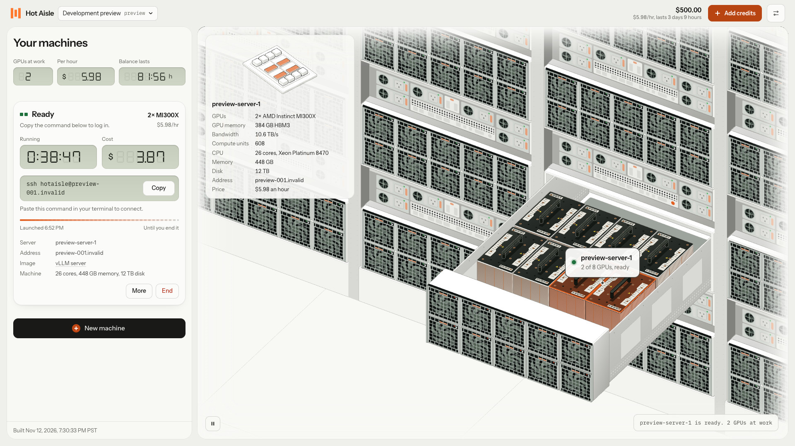
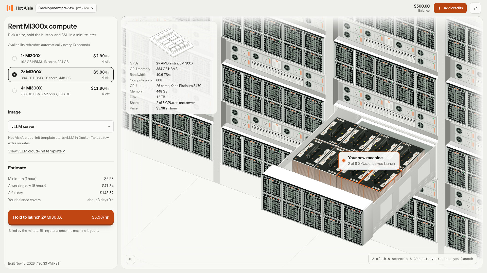

# hotaisle-console

Originally created by [StayLameBro](https://github.com/StayLameBro) as
[hotaisle-ui](https://github.com/StayLameBro/hotaisle-ui), now maintained by Hot Aisle.
The original Git history and MIT license are preserved.

A web app for renting [Hot Aisle](https://hotaisle.xyz) AMD MI300X GPUs. Sign in with your email or an API key, pick a
size, hold the launch button, SSH in, end it when you're done. Next to the controls is a live isometric drawing of the
Dell XE9680 servers your GPUs are on.

It runs on Cloudflare Workers: the Worker serves the app and is its backend. Built on the public
[Hot Aisle API](https://admin.hotaisle.app/api/docs/).



## Try it

Run it locally with sample data (Node 20+):

```sh
git clone https://github.com/hotaisle/hotaisle-console && cd hotaisle-console
npm install
cp .dev.vars.example .dev.vars        # then put 32+ random characters in it: openssl rand -base64 32
npm run dev                           # http://localhost:8787, then "Look around with sample data"
```

`http://localhost:8787/?demo` opens straight into sample data. Nothing is billed; it all runs in the browser tab.

## Deploy

[](https://deploy.workers.cloudflare.com/?url=https://github.com/hotaisle/hotaisle-console)

Or from your machine, with a Cloudflare account:

```sh
npx wrangler secret put SESSION_SECRET   # 32+ random characters
npm run build && npm run deploy
```

The Worker needs one secret, `SESSION_SECRET`, and uses one Durable Object class (`Account`). Workers Free is enough.

## Features

- Sign in with an emailed link or an API key. Passkeys once Hot Aisle's API supports them.
- Virtual machines with 1, 2 or 4 MI300X, or a whole 8-GPU server as bare metal, with live availability and prices.
- Image choice: standard, Hot Aisle's vLLM template, or your own cloud-init URL.
- Machine cards with boot progress, the SSH command (Copy, Open in Terminal), and running time and cost.
- Receipts when a machine ends, and a history of past runs that you can open and launch again.
- SSH keys: paste a public key, or remove one.
- Balance, spend per hour and time remaining; add credits through Hot Aisle's Stripe checkout.
- The drawing: your servers' GPU trays, with each GPU lit by state, every fan turning (WebGL), and labels on your
  servers. Point at any part to see what it is.
- Keyboard: `1` `2` `4` `8` pick a size, hold `L` to launch, `C` copies the newest SSH command, `Esc` goes back.
- Light and dark themes, sounds you can turn off, and reduced motion respected.
- Sample data: a built-in copy of the API that runs in the browser.



## How it works

```
browser ── /auth, /api, /records ──▶ Worker ──▶ admin.hotaisle.app/api
   │                                   │
   └── everything else: static files   └── Account Durable Object (one per account): launch records and history
```

- **Sign-in.** An API key is checked against `GET /user/` and used as `Authorization: Token <key>`. Email sign-in uses
  Hot Aisle's endpoints (below); its session token is used as `X-Session-Key: <token>`.
- **The session** is one cookie: encrypted and authenticated with AES-GCM under a key derived from `SESSION_SECRET`,
  `HttpOnly`, `Secure`, `SameSite=Strict`. The browser holds only ciphertext; the token is decrypted in the Worker for
  the length of a request and never reaches the page.
- **API calls.** The Hot Aisle API doesn't answer browsers directly, so the page calls `/api/*` and the Worker forwards
  it with the session's token.
- **Records.** Launch times and history live in a Durable Object per account, named by a hash of the account's
  email. No logins are stored on the server.
- **Staying signed in.** Email sessions last 20 minutes. With under a minute left, Hot Aisle answers any API call with
  a new key, and the Worker switches the session to it, so you stay signed in while the app is open. The old key keeps
  working until it expires, so requests already in flight finish.
- **No auto-end.** Hot Aisle's API can't schedule a shutdown, and a timer kept by the app could miss one and leave a
  machine billing, so the app doesn't offer one. Machines run until you end them; each card shows its running time
  and cost.
- **Guard.** `/auth`, `/api` and `/records` require `X-Requested-With: hotaisle-ui` and refuse cross-origin requests;
  with the `SameSite=Strict` cookie, other sites can't make these calls. Pages are served with a strict Content
  Security Policy.

## Email sign-in

| Hot Aisle endpoint | |
| --- | --- |
| `POST /api/user/email/login/` `{email}` | sends the approval email; returns `{email, claim_ticket, expires_at}` |
| `POST /api/user/email/wait/` `{claim_ticket}` | holds up to 20 s: `202` still waiting, `204` approved |
| `POST /api/user/email/complete/` `{claim_ticket}` | `204` with the session in `X-New-Session-Key` and `X-Session-Key-Expires`; `401` if unapproved, expired or used |

The claim ticket stays inside the encrypted session; the emailed link only approves the sign-in, in Hot Aisle's own
page. The session cookie lasts as long as Hot Aisle's session (at most 30 days).

`npm run dev:fake` runs the app against a local stand-in API that does the whole flow (the "email" is a link printed
in the terminal) and knows two API keys, `tok-alice` and `tok-bob`.

## Develop

Push changes to a descriptive branch and open a pull request into `main`. Merging requires an approving review,
passing `test` CI, signed commits, and resolved review threads. New commits dismiss earlier approvals; the final
push must be approved by someone other than its author. Direct pushes, force pushes, and deletion of `main` are
blocked, including for administrators.

CI builds the app, checks types, and runs Worker tests on GitHub-hosted Ubuntu 24.04 runners. Workflows from
external contributors' fork pull requests require approval before running. CI has a read-only repository token
and does not deploy. Production deployment requires a separately configured Cloudflare target and credentials;
the manual commands above remain available.

```sh
npm run dev          # build, then wrangler dev on http://localhost:8787
npm run dev:fake     # the same against a local stand-in API, to try sign-in
npm test             # Worker tests, in the Workers runtime, against the stand-in API
npm run typecheck    # Worker and app
npm run test:ui      # layout and motion checks in headless Chrome, at three window sizes
cd web && npm run watch   # rebuild the app on save while wrangler dev runs
```

- `worker/src/index.ts`: routes, the guard, sign-in and the API proxy. `session.ts`: the encrypted cookie.
  `account.ts`: the per-account Durable Object. `hotaisle.ts`: calls the Worker makes to Hot Aisle, including the
  email sign-in adapter.
- `shared/records.ts`: machine records and history, used by the Worker and by sample data.
- `web/`: the React + TypeScript app, built with Vite. `web/src/demo/` is the sample-data API.
- `web/src/iso/`: the drawing. `hall.ts` builds the racks and GPU trays, `chip.ts` the MI300X close-up, `fanGL.ts`
  the WebGL fans; `Stage.tsx` animates them.
- `web/tests/stability.mjs`: runs the app with `wrangler dev` in headless Chrome and fails on any layout shift,
  overflow or console error. `SHOTS=dir` saves screenshots.

See [AGENTS.md](AGENTS.md) for a guide to the code.

## Not yet tested against a real account

Everything has been run against sample data and a stand-in API that follows Hot Aisle's documentation, including its
email sign-in. Real accounts, the live email sign-in, bare metal (reserve, install, power, reinstall, release) and the
deploy button haven't been tried yet.

## Credits

Drawing kit: [Anatomy](https://github.com/wheresryan22/anatomy) by Ryan, MIT License (`web/src/iso/LICENSE-anatomy.txt`).
Hardware references: Dell PowerEdge XE9680 Technical Guide and Installation and Service Manual, Hot Aisle's compute,
pricing and data center pages, AMD's MI300X data sheet, and ServeTheHome's photographs of the MI300X OAM module.
Seven-segment digits: [DSEG](https://github.com/keshikan/DSEG) by keshikan, SIL Open Font License 1.1
(`web/src/fonts/DSEG-LICENSE.txt`). Type: Instrument Sans and IBM Plex Mono, both OFL.

## License

MIT
